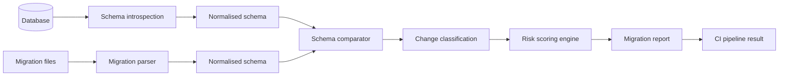

# SchemaSentry

> Detect dangerous database schema changes before they reach production.


[](LICENSE)


**Status: skeleton (v0.0.0).** This repository contains the project structure, architecture decisions and
an implementation plan. **Nothing is functional yet.** The word "works" does not appear below unless it is
true.

## Why this exists

Migration reviews are done by eye. "ALTER TABLE users ALTER COLUMN age TYPE varchar" looks
harmless in a pull request and takes the site down for eleven minutes. SchemaSentry compares the schema
you have with the schema the migration will produce, classifies the difference, and scores the risk
before the migration runs.

## What it will do

| Capability | Milestone | Status |
|---|---|---|
| Compare schema snapshots | M2 | Not started |
| Detect dropped columns and tables | M3 | Not started |
| Detect incompatible type changes | M3 | Not started |
| Flag potentially locking migrations | M3 | Not started |
| Detect missing indexes | M4 | Not started |
| Identify nullable/non-nullable changes | M3 | Not started |
| Estimate migration risk | M4 | Not started |
| Markdown and JSON reports | M4 | Not started |
| GitHub Actions integration | M5 | Not started |
| MySQL support | M6 | Not started |
| Migration performance analysis | M6 | Not started |

## Architecture



Full reasoning, data model, API surface and failure behaviour are in [docs/PLAN.md](docs/PLAN.md).

## Engineering challenge

Understanding semantic database changes instead of comparing SQL text. Two migrations can
produce identical schemas with completely different SQL, and one innocuous-looking statement can rewrite a
table of forty million rows.

## Quickstart

Not runnable yet. The skeleton builds and prints its version:

```bash
make bootstrap
.venv/Scripts/schemasentry version   # Windows
.venv/bin/schemasentry version          # macOS / Linux
```

Full local stack (Postgres, Redis, API, workers) arrives with
milestone M1.

## Repository layout

| Path | Purpose |
|---|---|
| `src/schemasentry/cli.py` | Typer commands: snapshot, compare, report |
| `src/schemasentry/introspect.py` | Reads pg_catalog and information_schema into a snapshot |
| `src/schemasentry/snapshot.py` | Snapshot model, serialisation, versioning |
| `src/schemasentry/diff.py` | Structural comparison of two snapshots |
| `src/schemasentry/rules` | One module per rule id (SS001...) |
| `src/schemasentry/dialects` | PostgreSQL dialect behaviour, lock estimates |
| `src/schemasentry/report` | Markdown and JSON renderers |
| `tests/corpus` | Golden migration cases, the accuracy contract |
| `action` | GitHub Action wrapper (M5) |

## Roadmap

| Milestone | Deliverable | Status |
|---|---|---|
| M1 | PostgreSQL introspection and normalised snapshot format | Not started |
| M2 | Snapshot storage and structural comparison | Not started |
| M3 | Change classification rules SS001-SS007 | Not started |
| M4 | Risk scoring, Markdown and JSON reports, exit codes | Not started |
| M5 | GitHub Action and CI integration | Not started |
| M6 | MySQL support and migration performance analysis | Not started |

This roadmap mirrors [docs/PLAN.md](docs/PLAN.md) section 12. If the two disagree, the plan is correct and
the README is a bug.

## Project standards

- Conventional Commits, Semantic Versioning, `main` is always green.
- Every release is produced by CI, never by a laptop.
- Status claims must match reality. Unbuilt features are marked "Not started", not "coming soon".
- Decisions are recorded as ADRs in [docs/adr/](docs/adr/).

## Contributing

Read [CONTRIBUTING.md](CONTRIBUTING.md) and [docs/PLAN.md](docs/PLAN.md) first. Issues labelled
`good first issue` are scoped for a first pull request.

## Using an AI assistant on this repository

Read [docs/PLAN.md](docs/PLAN.md) end to end, including the machine context block at the top. It states
what exists, what does not, and which claims are forbidden. Do not describe planned behaviour as
implemented behaviour.

## License

Apache License 2.0 - see [LICENSE](LICENSE).
