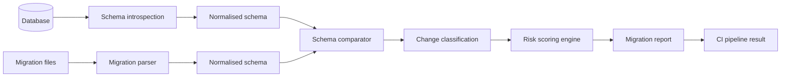

# SchemaSentry Architecture

**Status: partially implemented (M1).** Introspection and the snapshot format exist and are tested against
real PostgreSQL 13, 15 and 16 servers. There is no comparison engine, no rule and no report yet, so the
tool cannot yet say anything about a migration. This document describes intended structure; the
authoritative specification is [PLAN.md](PLAN.md), and section 0 there is the current truth.

## Context

Detect dangerous database schema changes before they reach production.

Migration reviews are done by eye. "ALTER TABLE users ALTER COLUMN age TYPE varchar" looks
harmless in a pull request and takes the site down for eleven minutes. SchemaSentry compares the schema
you have with the schema the migration will produce, classifies the difference, and scores the risk
before the migration runs.

## Intended shape

## Component responsibilities

See [PLAN.md](PLAN.md) section 6 for the responsibility of each box, the request and event flows, and the
failure behaviour of each stage.

## What is deliberately absent

See [PLAN.md](PLAN.md) section 4 (non-goals). If a component is not on that diagram, it is not part of the
design.
