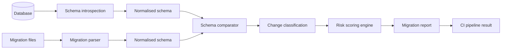

# SchemaSentry Architecture

**Status: M2 complete and merged into main.** Read-only introspection feeds deterministic snapshots;
offline structural comparison produces JSON changes. Risk classification, scoring, SQL prediction
and richer reports remain planned. [PLAN.md](PLAN.md) is authoritative; [ADR 0003](adr/0003-m2-structural-comparison.md)
records comparison semantics and evidence limits.

## Context

Detect dangerous database schema changes before they reach production.

Migration reviews are done by eye. "ALTER TABLE users ALTER COLUMN age TYPE varchar" looks
harmless in a pull request and takes the site down for eleven minutes. SchemaSentry compares the schema
you have with the schema the migration will produce, classifies the difference, and scores the risk
before the migration runs.

## Intended shape

## Component responsibilities

See [PLAN.md](PLAN.md) section 6 for the responsibility of each box, the request and event flows, and the
failure behaviour of each stage.

## What is deliberately absent

See [PLAN.md](PLAN.md) section 4 (non-goals). If a component is not on that diagram, it is not part of the
design.

## M3 preparation

M3 is **Not started**. Read [phase requirements](phases/M3.md) for planned contracts,
ADR decisions and acceptance gates, and [development tools](DEVELOPMENT-TOOLS.md) for actual coverage.
