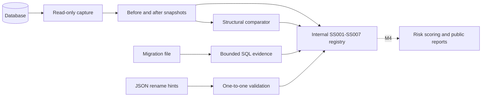

# SchemaSentry Architecture

**Status: M1–M3 complete and merged into main, including CI.** Read-only introspection feeds deterministic
snapshots; structural comparison and the internal SS001–SS007 registry consume those snapshots.
Optional SQL and rename hints supply bounded evidence. Risk scoring, migration-to-snapshot prediction
and public reports remain planned. [PLAN.md](PLAN.md) is authoritative;
[ADR 0003](adr/0003-m2-structural-comparison.md) preserves structural contracts and
[ADR 0004](adr/0004-m3-classification-evidence.md) defines classification evidence.

## Context

Detect dangerous database schema changes before they reach production.

Migration reviews are done by eye. "ALTER TABLE users ALTER COLUMN age TYPE varchar" looks
harmless in a pull request and takes the site down for eleven minutes. SchemaSentry compares the schema
you have with the schema the migration will produce, classifies the difference, and scores the risk
before the migration runs.

## Implemented flow

## Component responsibilities

See [PLAN.md](PLAN.md) section 6 for the responsibility of each box, the request and event flows, and the
failure behaviour of each stage.

`classification.py` calls the existing comparator, validates rename endpoints and binds supported
migration operations through `rules/_context.py`. The fixed registry evaluates each rule and returns
sorted immutable findings and notices. SQLGlot parsing preserves statement text/order/locations and
returns unsupported or parse-error entries; it does not generate an after snapshot or run SQL.
`rules/_semantics.py` keeps the reviewed type/default/CHECK/version prerequisites explicit.
SS005 separates lock acquisition from scans and rewrites. Unknown evidence prevents confirmed effects.

## What is deliberately absent

See [PLAN.md](PLAN.md) section 4 (non-goals). If a component is not on that diagram, it is not part of the
design.

## M3 validation

The [phase requirements](phases/M3.md) map to 59 reviewed cases and live PG13/15/16 evidence.
The [validation record](testing/m3-validation.md) records native gates, expected offline skips,
installed-runtime checks and a finite Python memory workload. Branch and PR CI passed the Python
3.12/3.13 checks, PG13/15/16 integration matrix and dependency audit.

## M4 preparation

[M4 requirements](phases/M4.md) and [proposed ADR 0005](adr/0005-m4-risk-and-report-contract.md) prepare
SS008–SS010 evidence, a pure scoring/public-report wrapper and separate `compare`/metadata commands.
The structural diff remains unchanged. Enum evidence compatibility, scoring/completeness and report
versions must be resolved before code; parsed SQL is secondary evidence, never an executed migration
or a predicted after snapshot. These features remain planned.
