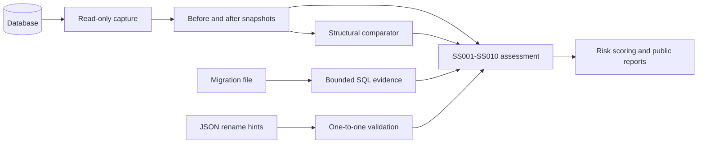

# SchemaSentry Architecture

**M4 is implemented and verified locally/in GitHub CI on `feat/m4-implementation`; PR #4 is open.**
M1–M3 remain merged. Read-only introspection feeds deterministic snapshots, structural comparison and
ten-rule public assessment. Optional SQL/hints supply bounded evidence. [PLAN.md](PLAN.md) is authoritative;
[ADR 0003](adr/0003-m2-structural-comparison.md) preserves structural contracts and
[ADR 0004](adr/0004-m3-classification-evidence.md) defines classification evidence;
[ADR 0005](adr/0005-m4-risk-and-report-contract.md) defines M4 catalog/scoring/report policy.

## Context

Detect dangerous database schema changes before they reach production.

Migration reviews are done by eye. "ALTER TABLE users ALTER COLUMN age TYPE varchar" looks
harmless in a pull request and can cause a long outage. SchemaSentry compares supplied/observed schema
states and explains policy risk. A staging after state can support review before production deployment.
Migration SQL is secondary evidence, never executed or used to predict the after state.

## Implemented flow

## Component responsibilities

See [PLAN.md](PLAN.md) section 6 for the responsibility of each box, the request and event flows, and the
failure behaviour of each stage.

`classification.py` calls the existing comparator, validates rename endpoints and binds supported
migration operations through `rules/_context.py`. The fixed registry evaluates each rule and returns
sorted immutable findings and notices. SQLGlot parsing preserves statement text/order/locations and
returns unsupported or parse-error entries; it does not generate an after snapshot or run SQL.
`rules/_semantics.py` keeps the reviewed type/default/CHECK/version prerequisites explicit.
SS005 separates lock acquisition from scans and rewrites. Unknown evidence prevents confirmed effects.

## What is deliberately absent

See [PLAN.md](PLAN.md) section 4 (non-goals). If a component is not on that diagram, it is not part of the
design.

## M3 validation

The [phase requirements](phases/M3.md) map to 59 reviewed cases and live PG13/15/16 evidence.
The [validation record](testing/m3-validation.md) records native gates, expected offline skips,
installed-runtime checks and a finite Python memory workload. Branch and PR CI passed the Python
3.12/3.13 checks, PG13/15/16 integration matrix and dependency audit.

## M4 assessment

[M4 requirements](phases/M4.md) and accepted [ADR 0005](adr/0005-m4-risk-and-report-contract.md) govern
`assessment.py`, the SS008–SS010 rules, public `compare` and offline registry commands.
Default M2 snapshot serialization, structural diff JSON/exits and the default seven-rule M3 classifier
remain compatible. `snapshot --analysis-evidence` opts into version-1 `catalogEvidence`; live `compare`
captures it in the same read-only REPEATABLE READ transaction with the five-second statement timeout.

`catalog_models.py` validates scope, relation/constraint facts, enum order/references and incoming FKs.
`catalog_capture.py` uses constant parameterized queries with a shared remaining row budget.
Foreign-key exposure includes outside-schema sources targeting captured tables. Unsupported domain/
composite wrappers and enum references outside scope remain gaps. Missing legacy evidence is unknown.

`m4_migration.py` extends supported secondary evidence without changing the M3 parser. Once M4 binding is
confirmed, it creates an immutable legacy classification view marking only those exact source locations
supported, with no invented M3 operations. This keeps supported mixed migrations from losing lock evidence;
unrecognized statements and transaction/version gaps remain incomplete. Caller inputs are unchanged.

Assessment canonicalizes validated snapshots before evaluating rules and producing evidence, so shuffled
catalog records cannot change report bytes. Duplicate column positions are rejected by M4 assessment;
structural diff retains its existing treatment of ordinals. The scorer retains base severity/confidence,
applies known size/FK modifiers once, caps at critical and aggregates the maximum. Reader ownership is
unavailable and `estimatedSeconds` stays null. Incomplete analysis takes precedence over risk exits.

`report.py` renders one immutable report as JSON or escaped Markdown, bounded before output. Format/bidi
controls become visible in Markdown. `report_io.py` checks writes/flushes and uses staged atomic replacement
without overwriting selected inputs. `registry.py` supplies ten metadata definitions; `make check-docs`
detects drift in their pages and public schemas. [M4 validation](testing/m4-validation.md) records the
native and installed-runtime evidence, 500-table profile and passing branch/PR GitHub CI.
