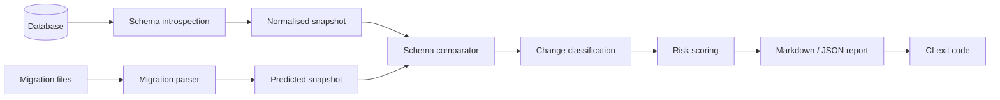

# SchemaSentry — Implementation Plan

> **This file is the specification.** Accuracy claims are defined by `tests/corpus/`, not by opinion.

---

## 0. Machine context

```yaml
project: SchemaSentry
status: mvp
version: 0.1.0
builds: true
functional: partial            # snapshotting works; nothing compares or judges yet

implemented:
  - typer cli with version and snapshot
  - snapshot --database, --output, --schema, --captured-at
  - read-only connection with statement_timeout = 5s
  - postgres dialect (pg_catalog introspection) for server majors 13 to 17
  - snapshot model with deterministic ordering and serialisation
  - committed json schema (docs/schema/snapshot-v1.schema.json) enforced by tests
  - integration suite that runs against a real postgres server
  - exit codes 0, 3 and 4 (1 and 2 belong to the comparison and risk milestones)

not_implemented:
  - snapshot comparison
  - change detection
  - classification rules
  - risk scoring
  - markdown and json reports
  - explain and rules commands
  - migration parsing (sqlglot)
  - hints and rename support
  - github action
  - mysql support

source_of_truth:
  scope_and_rules: docs/PLAN.md        # this file, section 9
  accuracy_contract: tests/corpus/     # a rule change that breaks a case is wrong
  architecture: docs/ARCHITECTURE.md
  decisions: docs/adr/
  status: README.md#roadmap
  snapshot_contract: docs/schema/snapshot-v1.schema.json

forbidden_claims:
  - "detects all dangerous migrations"
  - "safe" or "guaranteed" about any migration
  - support for a database version not in the support matrix
  - a rule that has no corpus case

if_uncertain:
  - add a corpus case before changing a rule
  - if lock behaviour is version-dependent, cite the PostgreSQL version in the rule
  - never estimate a duration without row counts; say "unknown" instead
```

---

## 1. What this is

A CLI and CI gate that compares the schema you have with the schema a migration will produce, classifies
each difference, and scores the risk before the migration touches production.

One-line description: *Detect dangerous database schema changes before they reach production.*

---

## 2. Problem and users

**Problem.** Migration review is done by eye, by people who are not database specialists, under time
pressure. `ALTER TABLE users ALTER COLUMN email TYPE varchar(320)` looks harmless. `ALTER TABLE orders ADD
COLUMN status text NOT NULL DEFAULT 'new'` takes an ACCESS EXCLUSIVE lock and — on older versions — rewrites
the table. Both pass review and fail in production at 09:00.

**Users.**

| User | Need |
|---|---|
| Backend developer | Know before merging whether a migration is dangerous |
| DBA / platform engineer | A policy gate that fails the build, with reasons |
| Reviewer | A short report that explains risk, not a wall of SQL |

**Success looks like.** A pull request that drops a column fails CI with a report naming the table, the
column and the safest alternative pattern.

---

## 3. Non-goals

- **Not a migration runner.** It does not apply migrations. Flyway, Alembic, Atlas and friends already exist.
- **Not a schema linter for style.** Naming conventions are somebody else's tool.
- **Not an ORM.** It reads the database, not your models.
- **Not a performance profiler.** It estimates lock *risk*, never query speed.
- **No hosted service.** CI and CLI only.
- **No "AI review" of migrations.** Rule-based, deterministic, reviewable.

---

## 4. Scope contract

### v0.1 — MVP (M1–M4)

PostgreSQL only. Snapshot, compare two snapshots, classify seven rules, score risk, Markdown and JSON
report, documented exit codes.

### v1.0 (M5–M6)

GitHub Action, baseline storage convention, MySQL dialect behind the same interface, performance analysis
on a real dataset, 100+ corpus cases.

### Post-1.0

SQLite, SQL Server, migration hints file format v2, historical drift detection, policy files.

---

## 5. Locked decisions

| # | Decision | Rationale |
|---|---|---|
| 1 | Python + Typer | `sqlglot` and the introspection ecosystem are Python-first; CI use needs no static binary |
| 2 | Compare normalised schema **state**, not SQL text | Text diffs are wrong in both directions |
| 3 | SQL parsing is a secondary signal | Used for lock and rewrite analysis, never for breakage decisions alone |
| 4 | PostgreSQL first, MySQL later | One dialect done properly; the dialect layer exists from M1 |
| 5 | Golden corpus defines accuracy | Rules are falsifiable by committed cases |
| 6 | Exit codes are public API | CI depends on them; changing them is a breaking change |
| 7 | Read-only database access | The tool never issues DDL or DML |
| 8 | Reports are deterministic | Same inputs produce byte-identical JSON, so diffs are reviewable |

**Rejected alternatives:** comparing `pg_dump` text output (formatting noise, unstable ordering), running the
migration on a copy and diffing (requires production-like data and time), an LLM reviewer (non-deterministic,
unauditable), Go (weaker SQL parsing ecosystem at the time of writing).

---

## 6. Architecture



**Two modes, one engine:**

1. **Diff mode** — compare two snapshot files (`--before`, `--after`). No database needed.
2. **Predict mode** — snapshot the live database, parse migration files, apply the *schema delta* to the
   snapshot in memory, compare. No migration is executed. Ever.

Mode 2 is best-effort by design: SQL that cannot be modelled statically is reported as
`unanalysable_statement` with the raw text, and the run exits `1` unless `--allow-unanalysable` is set.

---

## 7. Data model

**Snapshot** (`schemaVersion: 1`), JSON, sorted deterministically:

```json
{
  "schemaVersion": 1,
  "dialect": "postgres",
  "serverVersion": "16.4",
  "capturedAt": "2026-11-13T10:00:00Z",
  "database": "app",
  "schemas": ["public"],
  "tables": [
    {
      "schema": "public",
      "name": "users",
      "rowEstimate": 1820000,
      "totalBytes": 734003200,
      "columns": [
        {
          "name": "email",
          "ordinal": 3,
          "type": "character varying(255)",
          "normalisedType": "varchar",
          "length": 255,
          "nullable": false,
          "default": null,
          "identity": false,
          "generated": null
        }
      ],
      "constraints": [
        { "name": "users_pkey", "kind": "primary_key", "columns": ["id"] },
        { "name": "users_email_key", "kind": "unique", "columns": ["email"] }
      ],
      "indexes": [
        {
          "name": "users_email_idx",
          "columns": ["email"],
          "unique": false,
          "method": "btree",
          "predicate": null,
          "valid": true
        }
      ]
    }
  ],
  "sequences": [],
  "extensions": ["pgcrypto"]
}
```

Row estimates come from `pg_class.reltuples`; when the table has never been analysed, `rowEstimate` is `null`
and every size-dependent rule reports `confidence: low` instead of guessing.

The machine-readable contract is `docs/schema/snapshot-v1.schema.json`, and a test validates a real
captured snapshot against it. It adds three fields to the example above, each because the shorter form
would state something false: `generationExpression` on a generated column, `referencedTable` and
`referencedColumns` on a foreign key, and `expression` on an index. See ADR 0002.

**Finding** (`expected.json` in the corpus):

```json
{
  "changes": [
    {
      "ruleId": "SS001",
      "severity": "critical",
      "object": "users.email",
      "change": "column_removed",
      "details": { "type": "varchar(255)", "nullable": false }
    }
  ],
  "risk": "critical",
  "exitCode": 2,
  "lock": { "level": "access_exclusive", "rewritesTable": false, "estimatedSeconds": null }
}
```

---

## 8. Command surface and exit codes

```
schemasentry snapshot  --database URL --output snap.json
schemasentry compare   --baseline snap.json --database URL [--migrations ./migrations]
                       --format markdown|json --fail-on low|medium|high|critical
schemasentry diff      --before a.json --after b.json [--format ...]
schemasentry explain   <rule-id>
schemasentry rules     [--json]
schemasentry version
```

| Exit code | Meaning |
|---|---|
| 0 | No finding at or above `--fail-on` (default `high`) |
| 1 | Threshold crossed (report printed) |
| 2 | Blocking risk found (`critical`) |
| 3 | Tool error: connection, parse failure, unsupported dialect |
| 4 | Invalid usage |

`--database` is read from the environment by default (`SCHEMASENTRY_DATABASE_URL`), never from a flag in CI
logs. The tool opens a read-only transaction and sets `statement_timeout = 5s`.

Implemented in M1: `snapshot` (with `--database`, `--output`, `--schema`, `--captured-at`) and `version`.
The other commands are planned for M2 to M4. Exit codes 1 and 2 are unreachable in M1 because nothing
finds anything yet.

---

## 9. Rules

Stable ids. One page each in `docs/rules/`. Every rule has at least one corpus case.

| ID | Detects | Base severity | Notes |
|---|---|---|---|
| SS001 | Column removed | critical | Always breaks readers older than the deploy |
| SS002 | Column type changed | high | Some changes are safe; see table below |
| SS003 | NOT NULL added without a default | high | Full scan under ACCESS EXCLUSIVE unless `NOT VALID` |
| SS004 | Missing index on a foreign key | medium | Scaled by table size; write-path amplification |
| SS005 | Locking or rewriting statement | high | `ALTER TYPE`, `SET NOT NULL`, `ADD COLUMN ... DEFAULT`, `VACUUM FULL` |
| SS006 | Rename appearing as drop + add | high | Requires a rename hint file, otherwise data loss risk |
| SS007 | Volatile or non-constant default | medium | Volatile default rewrites the table on PG < 11 and forces a scan |
| SS008 | Constraint added without `NOT VALID` | medium | `VALIDATE CONSTRAINT` can be run separately |
| SS009 | Index created without `CONCURRENTLY` | medium | Blocks writes for the duration of the build |
| SS010 | Enum value removed or renamed | high | Values cannot be removed in PostgreSQL |

**Type-change nuance for SS002** (the rule must not cry wolf):

| Change | Verdict |
|---|---|
| `varchar(50)` → `varchar(100)` | safe, no rewrite |
| `varchar(100)` → `varchar(50)` | high, data truncation |
| `int` → `bigint` | medium, table rewrite |
| `bigint` → `int` | high, overflow risk |
| `text` → `varchar(n)` | high, needs validation query |
| `timestamp` → `timestamptz` | high, silent timezone reinterpretation |
| `numeric(p,s)` widening | medium, rewrite |

**Risk scoring.** `risk = max(base severity, size modifier, lock modifier)`, then one level up if the object is
referenced by a foreign key or a unique constraint.

| Modifier | Condition |
|---|---|
| +1 level | table is referenced by 2+ foreign keys |
| +1 level | `rowEstimate > 1,000,000` |
| +2 levels | `rowEstimate > 20,000,000` |
| +1 level | operation takes ACCESS EXCLUSIVE and table is read by another service (declared in hints) |

`estimatedSeconds` is only produced when `rowEstimate` is known **and** the statement is a rewrite; otherwise
`null`. A null is honest; a guess is not.

**Every finding carries a `safeAlternative`** where one exists:

- SS001 → expand/contract: stop reading the column, deploy, then drop in a later migration.
- SS003 → `ADD CONSTRAINT ... NOT VALID` then `VALIDATE CONSTRAINT`.
- SS009 → `CREATE INDEX CONCURRENTLY`.
- SS006 → rename hint file, or expand/contract.

---

## 10. Repository layout

```
schemasentry/
├── src/schemasentry/
│   ├── cli.py              typer commands
│   ├── introspect.py       pg_catalog + information_schema readers
│   ├── snapshot.py         models, serialisation, deterministic ordering
│   ├── diff.py             structural comparison
│   ├── rules/              one module per rule id
│   ├── dialects/           postgres.py, mysql.py (M6)
│   ├── hints.py            rename and ownership hints
│   └── report/             markdown.py, json.py
├── tests/
│   ├── corpus/             the accuracy contract
│   ├── fixtures/           snapshot pairs
│   ├── unit/
│   └── integration/        real Postgres in docker
├── action/                 GitHub Action wrapper (M5)
└── docs/                   plan, architecture, rules, ADRs
```

---

## 11. Milestones

### M1 — Introspection and snapshot format

**Deliverable:** `snapshot` command producing a deterministic JSON snapshot from PostgreSQL 13–17.

**Acceptance criteria**

- [x] Captures tables, columns, types, nullability, defaults, identity, constraints, indexes, sequences
- [x] Two runs against an unchanged database produce byte-identical output
- [x] Read-only transaction; `statement_timeout` enforced
- [x] Row estimates are null, not zero, for unanalysed tables
- [ ] Integration tests run against PG 13, 15 and 16 in CI
- [x] Unknown column types are preserved verbatim, not dropped

Status note: the integration suite passes against a real PostgreSQL 13.23, 15 and 16.16 server, run
locally with Docker on 2026-11-13. The CI workflow defines the same three-version matrix, but it has
never executed because the repository has no remote yet, so that checkbox stays open. Byte-identical
output requires a fixed `capturedAt`: use `--captured-at` or `SOURCE_DATE_EPOCH`, as the test suite
does. The snapshot format is pinned by `docs/schema/snapshot-v1.schema.json` and validated by the
test suite. ADR 0002 records the decisions made along the way, including the PostgreSQL 13 versus 14
difference in how an unanalysed table reports its row estimate.

### M2 — Comparison engine

**Deliverable:** `diff` command over two snapshot files with structural change detection.

**Acceptance criteria**

- [ ] Added/removed tables, columns, constraints and indexes detected
- [ ] Column order changes and renamed constraints do not produce false changes
- [ ] Output is deterministic and sorted by (schema, table, object)
- [ ] 20 fixture pairs with expected change sets, all passing
- [ ] Comparison of a 500-table snapshot completes in under 10 s

### M3 — Classification rules

**Deliverable:** rules SS001–SS007 with corpus cases.

**Acceptance criteria**

- [ ] Every rule has at least 3 corpus cases: one positive, one negative, one edge
- [ ] SS002 type matrix implemented exactly as specified in section 9
- [ ] SS006 requires a hint file; without one it reports both drop and add
- [ ] Unanalysable statements are reported, never silently ignored
- [ ] Corpus suite runs in under 60 s

### M4 — Risk scoring and reports

**Deliverable:** risk levels, Markdown and JSON reports, exit codes, `explain`.

**Acceptance criteria**

- [ ] Risk modifiers applied and unit-tested at boundary row counts
- [ ] `estimatedSeconds` is null unless row count and rewrite are both known
- [ ] Markdown report matches the documented template, including safe alternatives
- [ ] Exit codes match section 8 exactly
- [ ] Report is byte-identical across runs for identical input

### M5 — GitHub Action

**Deliverable:** Action that snapshots, compares against a committed baseline, and fails the check.

**Acceptance criteria**

- [ ] Action runs in under 60 s on a 500-table schema
- [ ] Report is posted as a PR comment, updated in place, not duplicated
- [ ] Threshold configurable via `fail-on`
- [ ] Secrets never appear in logs or comments
- [ ] Baseline convention documented: `db/schema/snapshot.json` on the default branch

### M6 — MySQL and performance analysis

**Deliverable:** MySQL dialect, lock estimation improvements, v1.0.0.

**Acceptance criteria**

- [ ] Dialect interface proven by a second implementation
- [ ] MySQL-specific rules documented separately, no silent divergence
- [ ] Corpus exceeds 100 cases and passes in CI
- [ ] Performance analysis on a 10M-row table documented with real timings
- [ ] `CHANGELOG.md` and README roadmap complete

---

## 12. Backlog

| ID | Task | Depends | Milestone |
|---|---|---|---|
| SS-001 | Typer CLI skeleton, config, exit-code helpers | — | M1 |
| SS-002 | Connection layer with read-only transaction | SS-001 | M1 |
| SS-003 | Snapshot Pydantic models | — | M1 |
| SS-004 | Table + column introspection | SS-002, SS-003 | M1 |
| SS-005 | Constraint and index introspection | SS-004 | M1 |
| SS-006 | Deterministic serialiser | SS-003 | M1 |
| SS-007 | Integration harness with PG 13/15/16 | SS-002 | M1 |
| SS-008 | Row estimate and size capture | SS-004 | M1 |
| SS-009 | Object matcher (stable keys) | SS-003 | M2 |
| SS-010 | Table and column diff | SS-009 | M2 |
| SS-011 | Constraint and index diff | SS-009 | M2 |
| SS-012 | Fixture pairs and golden diff tests | SS-010 | M2 |
| SS-013 | Rule framework + registry | SS-010 | M3 |
| SS-014 | SS001 drop column | SS-013 | M3 |
| SS-015 | SS002 type change matrix | SS-013 | M3 |
| SS-016 | SS003 not-null without default | SS-013 | M3 |
| SS-017 | SS004 missing fk index | SS-013 | M3 |
| SS-018 | SS005 locking statements | SS-013 | M3 |
| SS-019 | SS006 rename hints | SS-013 | M3 |
| SS-020 | SS007 volatile default | SS-013 | M3 |
| SS-021 | Risk scoring engine | SS-014 | M4 |
| SS-022 | Markdown renderer | SS-021 | M4 |
| SS-023 | JSON renderer and determinism tests | SS-021 | M4 |
| SS-024 | `explain` command and rule docs | SS-013 | M4 |
| SS-025 | Corpus expansion to 60 cases | SS-020 | M4 |
| SS-026 | Migration parser (sqlglot) | SS-009 | M5 |
| SS-027 | GitHub Action and PR comment | SS-022 | M5 |
| SS-028 | Baseline convention and docs | SS-027 | M5 |
| SS-029 | MySQL dialect | SS-009 | M6 |
| SS-030 | Lock estimation on real datasets | SS-021 | M6 |

---

## 13. Testing strategy

- **Corpus:** `tests/corpus/<nnnn>-<slug>/` with `before.sql`, `migration.sql`, `expected.json`,
  `notes.md`. This is the contract. New rules start with a failing case.
- **Snapshot determinism:** capture twice, assert byte equality.
- **Real database:** integration tests use Docker Postgres; no mocked catalog queries — the whole point is
  that real catalogs are messy.
- **Negative cases:** every rule needs a "does not fire" case to prevent false positives.

**Targets:** snapshot of 500 tables < 5 s; diff < 10 s; full corpus < 60 s; memory < 300 MB.

---

## 14. Security and threat model

| Threat | Mitigation |
|---|---|
| Tool writes to the database | Read-only transaction, no DDL/DML in the codebase, test asserts no write statements |
| Credentials leak into reports | DSN never serialised; connection info reduced to host/database name |
| Malicious SQL in a migration file | Files are parsed, never executed |
| Supply chain | `pip-audit` in CI, pinned lockfile |
| Report injection in PR comments | Markdown escaped; no raw SQL in comment bodies beyond a fenced block |

---

## 15. Risks and open questions

| Risk | Impact | Mitigation |
|---|---|---|
| Static prediction diverges from real DDL | Wrong risk score | Report `confidence`; corpus grows with every bug report |
| Lock behaviour differs across PG versions | Bad estimates | Version-aware rule table, cited in docs |
| False positives annoy users | Tool disabled in CI | Conservative defaults, `--fail-on`, safe alternatives in every finding |
| Dialect abstraction leaks | MySQL becomes a fork | Dialect interface defined in M1, proven in M6 |

**Open questions:**

1. Should baseline snapshots be stored in the repo or as CI artifacts? *Current: repo, reviewable.*
2. Do we support `--fail-on medium`? *Current: yes, thresholds are a user policy.*
3. Is a hints file the right mechanism for renames, or should we infer from column comments? *Current: hints
   file, explicit and reviewable.*

---

## 16. Anti-hallucination contract

**Facts:** the package imports, `schemasentry version` prints `0.1.0`, and `schemasentry snapshot`
captures a deterministic JSON snapshot of a PostgreSQL 13 to 17 database through a read-only
transaction. There is no comparison, no rule, no risk score, no report and no corpus case.

**Rules:**

1. Never say a migration is safe. Report risk and evidence.
2. A rule without a corpus case does not exist, even if the code exists.
3. Never invent `estimatedSeconds`. Null is the correct answer when row counts are unknown.
4. Do not claim support for a PostgreSQL version that is not in the CI matrix.
5. SQL that cannot be modelled must appear as `unanalysable_statement`, never be dropped.
6. Update the rule table, README roadmap and CHANGELOG in the same pull request.

**Glossary:**

| Term | Meaning |
|---|---|
| Snapshot | Deterministic JSON representation of schema state. |
| Baseline | A snapshot committed as the reference for CI. |
| Change | One structural difference between two snapshots. |
| Finding | A change plus a rule verdict and risk. |
| Risk | Highest applicable severity after modifiers. |
| Unanalysable | A statement the parser cannot model; always surfaced. |
| Hint | A user declaration (e.g. rename) that rules may rely on. |

---

## 17. Handoff protocol

1. Read sections 0, 3 and 9.
2. `make bootstrap && make test`. The corpus suite should be green and empty.
3. Start at M1, task SS-003. Do not write a rule before introspection is trustworthy.
4. Before changing a rule, add the corpus case that proves the change.
5. If a finding is wrong, the fix is a new case plus a rule change — never a special case in the renderer.
